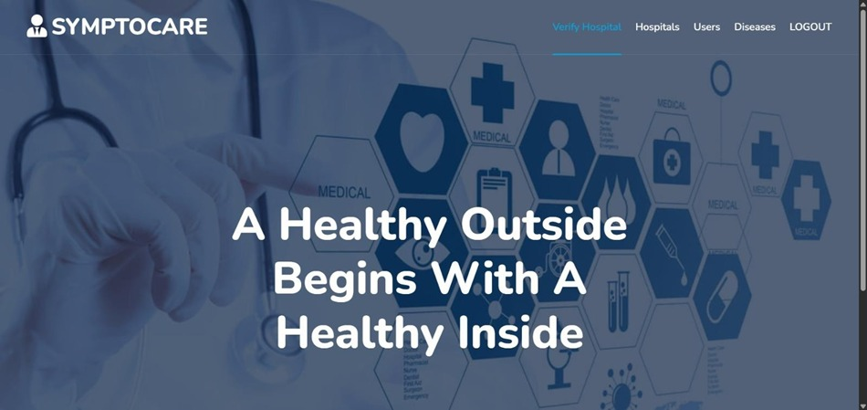
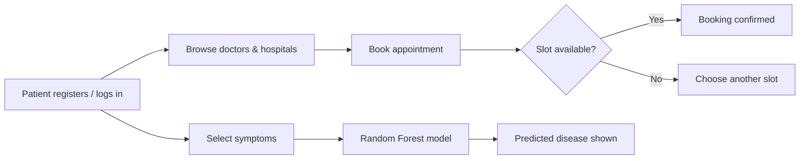

<div align="center">

# 🏥 SymptoCare

### Hospital Management System with AI-Based Disease Prediction

*One platform for hospitals, doctors and patients: appointments, profiles, and symptom-based disease prediction.*


[Features](#-features) • [Screenshots](#-screenshots) • [How It Works](#-how-it-works) • [Tech Stack](#-tech-stack) • [Getting Started](#-getting-started) • [Roadmap](#-roadmap)

</div>

---

## 📖 About

**SymptoCare** is a full-stack Django web application that simplifies hospital operations. It provides separate, role-based workflows for **Admins, Hospitals, Doctors and Patients**, covering registration, scheduling and appointment booking.

It also includes a **machine-learning disease prediction module**: a patient selects their symptoms and the system suggests a likely condition using a Random Forest classifier.

> ⚠️ **Disclaimer:** The prediction feature is an academic project and is **not a substitute for professional medical advice**.

---

## ✨ Features

| Role | What they can do |
|---|---|
| 🛡️ **Admin** | Manage hospitals, doctors, patients and the whole system from one dashboard |
| 🏥 **Hospital** | Register, manage the hospital profile, assign doctors, manage schedules |
| 👨‍⚕️ **Doctor** | Create a professional profile, set specialization and availability, view appointments |
| 👤 **Patient** | Register, search doctors, book appointments, view medical history, predict disease from symptoms |

**Highlights**
- 🔐 Multi-role authentication using Django's auth system
- 📅 Appointment scheduling with **conflict resolution** (no double booking)
- ⭐ Rating and review system for doctors and hospitals
- 🤖 **AI disease prediction** from symptoms
- 🔌 REST APIs for **[list what the APIs expose, e.g. doctors, appointments]**
- 📱 Responsive design for desktop, tablet and mobile
- 🗄️ Normalized relational schema with **13+ tables**

---

## 📸 Screenshots

<div align="center">

| Home Page |
|:---:|
|  |

</div>  |

| Appointment Booking | Disease Prediction |
|---|---|
|  |  |

<details>
<summary><b>🔎 More screenshots (Admin, Doctor, Hospital)</b></summary>

| Admin Dashboard | Doctor Dashboard | Hospital Dashboard |
|---|---|---|
|  |  |  |

</details>

---

## ⚙️ How It Works



### 🤖 Disease Prediction Module

| Item | Details |
|---|---|
| **Algorithm** | Random Forest Classifier (scikit-learn) |
| **Dataset** | 4,921 medical records, 132 symptom features **[add dataset source]** |
| **Target** | **[number]** disease classes |
| **Accuracy** | **[XX]%** on a held-out test set |
| **Integration** | Trained model loaded in Django and queried from the patient's prediction page |

---

## 🛠️ Tech Stack

| Layer | Technology |
|---|---|
| **Backend** | Python, Django, Django ORM |
| **Database** | MySQL **[or SQLite for development]** |
| **Frontend** | HTML5, CSS3, Bootstrap, JavaScript |
| **Machine Learning** | scikit-learn, Pandas, NumPy |
| **Authentication** | Django Auth System |
| **Other** | Pillow (image handling) |

---

## 🗂️ Project Structure

```
symptocare/
├── manage.py
├── requirements.txt
├── .env.example
├── symptocare/          # Project settings and URLs
├── [app_name]/          # Hospital, doctor, patient, appointment logic
├── templates/           # HTML templates
├── static/              # CSS, JS, images
├── ml_model/            # Trained model and training notebook/script
└── screenshots/         # README images
```
*(Adjust folder names to match your repo.)*

---

## 🚀 Getting Started

### Prerequisites
- Python 3.10+
- MySQL **[optional, if using MySQL]**
- Git

### Installation

```bash
# 1. Clone the repository
git clone https://github.com/athilaashraf/[REPO-NAME].git
cd [REPO-NAME]

# 2. Create and activate a virtual environment
python -m venv venv
venv\Scripts\activate        # Windows
# source venv/bin/activate   # macOS / Linux

# 3. Install dependencies
pip install -r requirements.txt

# 4. Configure environment variables
cp .env.example .env         # then edit .env with your values

# 5. Apply migrations
python manage.py migrate

# 6. Create an admin account
python manage.py createsuperuser

# 7. Run the server
python manage.py runserver
```

Open **http://127.0.0.1:8000/** in your browser.

### Environment Variables

Create a `.env` file (never commit it):

```env
SECRET_KEY=your-django-secret-key
DEBUG=True
DB_NAME=symptocare
DB_USER=your_db_user
DB_PASSWORD=your_db_password
DB_HOST=localhost
DB_PORT=3306
```

---

## 🔌 API Endpoints

> **[Replace with your real endpoints, or delete this section if there is no API.]**

| Method | Endpoint | Description |
|---|---|---|
| GET | `/api/doctors/` | List doctors |
| GET | `/api/appointments/` | List appointments |
| POST | `/api/predict/` | Predict disease from symptoms |

---

## 🔒 Security Notes

- Secrets are loaded from environment variables, not hardcoded
- Django's built-in protection against CSRF, XSS and SQL injection
- Role-based access control on every dashboard
- `DEBUG=False` for production

---

## 🗺️ Roadmap

- [x] Multi-role authentication
- [x] Appointment booking with conflict handling
- [x] Disease prediction using Random Forest
- [ ] Email / SMS appointment reminders
- [ ] Online payment integration
- [ ] Prediction explanations (feature importance)
- [ ] Docker support and cloud deployment

---

## 🤝 Contributing

Contributions are welcome. Fork the repo, create a feature branch, and open a pull request.

---

## 👩‍💻 Author

**Athila Ashraf**
MCA Graduate | Software Developer | AI Enthusiast

[](https://linkedin.com/in/athilaashraf)
[](https://github.com/athilaashraf)

---

<div align="center">

⭐ If you found this project useful, consider giving it a star!

</div>
